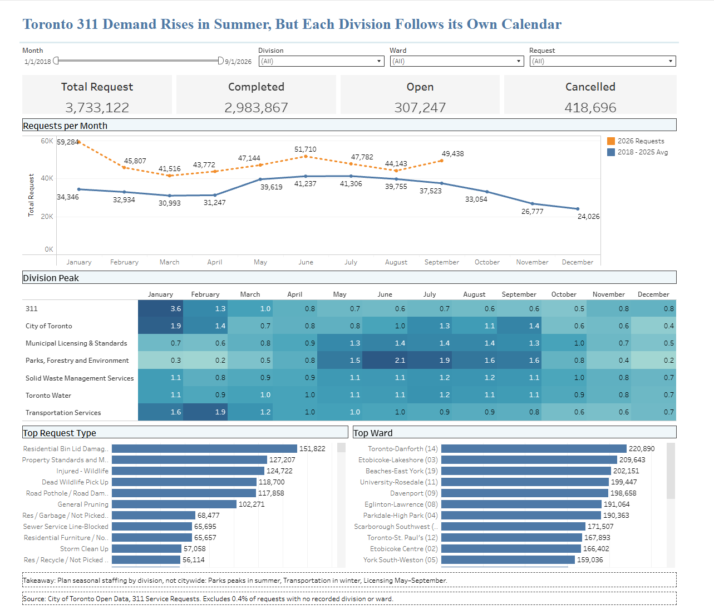

# Toronto 311 Service Requests, 2018–2026 (Tableau)

**Demand peaks in summer, but each city division peaks at a different time.**

🔗 **[View the live dashboard on Tableau Public](https://public.tableau.com/app/profile/michael.lee4471/viz/Toronto311_17931763684290/Toronto311)**

## The question
When do Toronto residents need city services most, and does every division get busy at the same time?

## The data
- **Source:** City of Toronto Open Data, 311 Service Requests
- **Period:** January 2018 to September 2026
- **Size:** 3.7M+ service requests
- 311 is the city's single front door: residents report issues by phone, app or web, and 311 sends each request to the responsible division.

## How I built it
1. **Combined and cleaned** the yearly files: standardized status and division names and removed duplicate rows.
2. **Grouped tree-related divisions** (Urban Forestry, Environment, and Parks, Forestry & Recreation) into one group, because tree services moved to a new division in 2025.
3. **Excluded** requests with no recorded division or ward (0.4% of requests).
4. **Built a Tableau dashboard** with KPI tiles, a monthly trend line, a division-by-month heatmap, and top request types and wards.

## Key findings
- **Demand rises in summer.** An average July (about 41,300 requests) is roughly 1.7 times an average December (about 24,000).
- **Each division follows its own calendar.** Transportation peaks in January and February, Parks, Forestry and Environment in June, and Municipal Licensing & Standards from May to September.
- **2026 is running about 10% above 2025** (January to September).
- **80% of requests are completed,** 11% are cancelled, and 8% are still open.

## Recommendation
**Plan seasonal staffing by division, not citywide.**

## Limitations
- Cancelled and open statuses may reflect recording practices, not service performance.
- The data shows when requests come in, not why.

## Files
- `Images/` – dashboard screenshots
